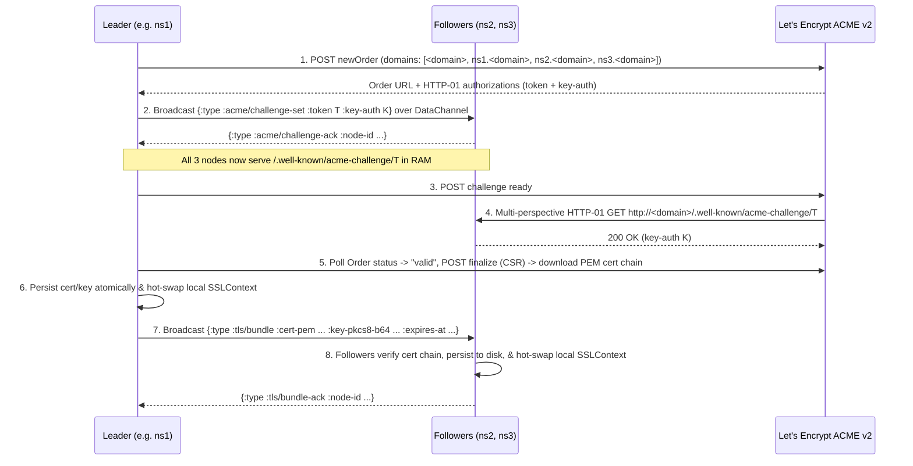

# `clj-web` Design Document

## 1. Overview & Goals

`clj-web` is a self-contained, zero-framework Clojure system targeting **JVM 25** that combines:
1. **Authoritative DNS Nameserver** (UDP & TCP port 53 — `A`, `AAAA`, `NS`, `SOA`, `MX`, `TXT`, `CAA`)
2. **HTTP/HTTPS Static Web Server** (TCP ports 80 & 443 via JDK's `com.sun.net.httpserver`)
3. **Inbound SMTP Server** (TCP port 25 with `STARTTLS` for receiving domain/registrar/verification emails)
4. **ACME v2 (Let's Encrypt) Client** with automated certificate provisioning and zero-downtime renewal
5. **3-Node Peer-to-Peer Cluster Control Plane** powered by [`datachannel-clj`](https://github.com/alpeware/datachannel-clj) (SCTP over DTLS over UDP) for leader election, peer health probing, ACME challenge synchronization, TLS keypair distribution, and inbound email replication

### Target Environment & Hard Constraints

| Dimension | Constraint / Target | Design Implication |
| :--- | :--- | :--- |
| **Runtime** | OpenJDK 25 | Virtual threads (`newVirtualThreadPerTaskExecutor`), Compact Object Headers (`-XX:+UseCompactObjectHeaders`), modern `java.security` (Ed25519 / ECDSA P-256) & `java.net.http.HttpClient`. |
| **Compute & Memory** | 3x GCP `e2-micro` VMs (2 shared vCPUs, **1 GB RAM**, 30 GB disk) | JVM heap capped at `-Xmx512m` (`-Xms256m`), bounded in-memory asset cache (128 MB max), zero-copy NIO file streaming for large JARs. |
| **Network Egress** | **1 GB / month** free-tier egress per VM | Aggressive `ETag` / `304 Not Modified`, pre-computed `.gz` compression, strict per-IP token-bucket rate limiting, no bloat (no JS/CSS frameworks), DNS amplification guards, no DNSSEC bloat. |
| **Redundancy** | 3 static IPv4/IPv6 nodes (`ns1`, `ns2`, `ns3`) | Registered as personal nameservers via Namecheap glue records; DNS returns all healthy node IPs (`TTL 60s`) and `MX` records pointing to the cluster. |
| **Primary Audience** | Autonomous AI agents & CLI tools (`curl`, `deps.edn`, `mvn`) | Deterministic plain-text/Markdown docs, `.clj` source, scripts, and Maven/Clojure JAR artifacts (`Content-Type`, `ETag`, `SHA-256` headers, HTTP `Range` support). |
| **Dependencies** | Minimal runtime dependencies | Only `org.clojure/clojure`, `org.clojure/data.json` (for ACME JSON/JWS), and `alpeware/datachannel-clj` (pure Clojure WebRTC DataChannels). |

---

## 2. System Architecture & Topology

### 2.1 3-Node Redundant Topology

All three `e2-micro` instances run an identical `clj-web` binary and configuration (differing only in `:node/id` and local bind address).

```
                     Namecheap Registrar Glue Records
             ns1.<domain> -> IP1, ns2.<domain> -> IP2, ns3.<domain> -> IP3
                                      |
          +---------------------------+---------------------------+
          |                           |                           |
          v                           v                           v
  +---------------+           +---------------+           +---------------+
  |   Node 1      | <=======> |   Node 2      | <=======> |   Node 3      |
  | (e2-micro)    |  UDP 5000 | (e2-micro)    |  UDP 5000 | (e2-micro)    |
  |               |  SCTP/DTLS|               |  SCTP/DTLS|               |
  | - DNS :53     |           | - DNS :53     |           | - DNS :53     |
  | - SMTP :25    |           | - SMTP :25    |           | - SMTP :25    |
  | - HTTP :80    |           | - HTTP :80    |           | - HTTP :80    |
  | - HTTPS :443  |           | - HTTPS :443  |           | - HTTPS :443  |
  +---------------+           |---------------+           +---------------+
```

### 2.2 Separation of Pure Core ("Sans-IO") and I/O Edges

Following the architectural style of `datachannel-clj`, `clj-web` separates pure protocol state machines from thin JDK NIO/socket wrappers:

```
src/
└── web/
    ├── main.clj            ;; CLI entrypoint, EDN config loader, lifecycle & shutdown hooks
    ├── config.clj          ;; Configuration defaults, normalization & validation
    ├── dns/
    │   ├── codec.clj       ;; Pure RFC 1035 DNS packet parser & serializer (byte[] <-> Clojure map)
    │   ├── resolver.clj    ;; Pure authoritative zone lookup (A/AAAA/NS/SOA/MX/TXT/CAA) + health filtering
    │   └── server.clj      ;; Java NIO DatagramChannel (UDP :53) + Virtual-Thread ServerSocket (TCP :53)
    ├── cluster/
    │   ├── protocol.clj    ;; Pure leader election, heartbeat tracker, & state replication reducer
    │   └── mesh.clj        ;; datachannel-clj node manager connecting the 3 peers over UDP :5000
    ├── acme/
    │   ├── jws.clj         ;; Pure ES256 JWS signing, thumbprints, CSR (PKCS#10) & PEM encoding
    │   └── client.clj      ;; RFC 8555 ACME v2 state machine over java.net.http.HttpClient
    ├── tls/
    │   └── context.clj     ;; KeyStore builder, self-signed bootstrap & hot-swappable SSLContext holder
    ├── smtp/
    │   ├── session.clj     ;; Pure RFC 5321 inbound SMTP state machine (EHLO/STARTTLS/MAIL/RCPT/DATA)
    │   └── server.clj      ;; Virtual-Thread TCP :25 server with STARTTLS upgrade & .eml disk persistence
    └── http/
        ├── server.clj      ;; Enhanced com.sun.net.httpserver wrapper (HTTP :80 & HTTPS :443)
        ├── content.clj     ;; Static asset resolver, LRU RAM cache, ETag, Range & Gzip handler
        └── ratelimit.clj   ;; Token-bucket per-IP request & egress bandwidth limiter
```

---

## 3. Authoritative Nameserver & DNS (`web.dns.*`)

### 3.1 Personal Nameservers & Glue Records (Namecheap)

To make the three VMs self-hosting nameservers for `<domain>` (e.g., `alpeware.com` or `alpeware.dev`):
1. In **Namecheap -> Domain List -> Advanced DNS -> Personal DNS Server**, register three glue records at the TLD registry:
   - `ns1.<domain>` $\rightarrow$ `<VM-1 IPv4>` (and optional IPv6)
   - `ns2.<domain>` $\rightarrow$ `<VM-2 IPv4>`
   - `ns3.<domain>` $\rightarrow$ `<VM-3 IPv4>`
2. In **Namecheap -> Domain -> Nameservers**, set **Custom DNS** to `ns1.<domain>`, `ns2.<domain>`, `ns3.<domain>`.
3. Each `clj-web` node serves authoritative answers for both the apex (`<domain>`), nameserver hosts (`ns1..ns3.<domain>`), and any configured subdomains (`*` or explicit hosts).

### 3.2 Supported Record Types & RFC 1035 Wire Format

`web.dns.codec` implements a pure, zero-dependency parser and serializer for RFC 1035 messages:
- **Header (12 bytes)**: `ID`, `QR=1`, `Opcode=0`, `AA=1` (Authoritative Answer), `TC`, `RD` (copied from query), `RA=0` (Recursion Available is **always 0**—we never act as an open resolver), `RCODE` (`0` NOERROR, `3` NXDOMAIN, `4` NOTIMP, `5` REFUSED).
- **Supported QTYPEs**:
  - `A` (`1`): Returns 32-bit IPv4 addresses.
  - `AAAA` (`28`): Returns 128-bit IPv6 addresses (if configured; otherwise `NOERROR` with 0 answers, `SOA` in authority section).
  - `NS` (`2`): Returns `ns1.<domain>`, `ns2.<domain>`, `ns3.<domain>`.
  - `SOA` (`6`): Returns primary NS (`ns1.<domain>`), hostmaster (`hostmaster.<domain>`), serial (epoch/config timestamp), refresh `3600`, retry `600`, expire `604800`, minimum (negative cache TTL) `60`.
  - `MX` (`15`): Returns 16-bit preference + mail exchange host (defaults to `10 ns1.<domain>`, `20 ns2.<domain>`, `30 ns3.<domain>`, or custom external MX records).
  - `TXT` (`16`): Serves static TXT records including email policy records (`SPF`, `_dmarc.<domain>`, `<selector>._domainkey.<domain>`) and dynamic `_acme-challenge.<domain>` records if needed.
  - `CAA` (`257`): Returns `0 issue "letsencrypt.org"` to restrict certificate issuance to Let's Encrypt.
  - `ANY` (`255`): Per RFC 8482, returns a minimal single `HINFO` or `A` record rather than a large response to prevent amplification.

### 3.3 Health-Aware Multi-A / AAAA & MX Resolution

- **Apex & Web Subdomains (`@`, `www`, `docs`, `mvn`, etc.)**:
  - The resolver inspects the cluster health table maintained by `web.cluster.protocol`.
  - All currently **healthy** node IPs (nodes with a valid heartbeat within the last 15 seconds, plus the local node itself) are returned in the Answer section with `TTL = 60` seconds.
  - Answer order is rotated (round-robin per query) to distribute client traffic evenly across healthy VMs.
  - **Fail-safe**: If a network partition isolates a node so it sees no peers, it still returns **its own IP** so DNS resolution never goes dark.
- **Nameserver & Mail Exchange Hosts (`ns1.<domain>`, `ns2.<domain>`, `ns3.<domain>`)**:
  - Always resolve deterministically to their respective static IP (`TTL = 3600`) to match TLD glue records and allow `MX` failover (`10 ns1`, `20 ns2`, `30 ns3`).

### 3.4 DNS Security, Egress Protection & Why DNSSEC is Omitted

1. **No Open Recursion**: Queries for domains outside the configured authoritative zone immediately receive `RCODE = 5 (REFUSED)` with an empty answer section.
2. **0x20 Bit Case Preservation**: The Question section echoes the exact ASCII casing of the incoming `QNAME` (draft-vixie-dnsext-dns0x20) to support upstream resolvers that use mixed-case entropy against cache poisoning.
3. **UDP Truncation & TCP Fallback**: UDP responses exceeding 512 bytes set `TC = 1` and truncate cleanly, prompting the client to retry over TCP port 53.
4. **Response Rate Limiting (RRL)**: A lightweight per-`/24` IPv4 (and `/56` IPv6) token bucket caps identical UDP DNS responses at 20 queries/sec to neutralize spoofed UDP reflection/amplification attacks before they consume our 1 GB/month egress.
5. **Explicit Omission of DNSSEC**:
   - DNSSEC (`DNSKEY`, `RRSIG`, `NSEC`) significantly enlarges UDP DNS responses, increasing amplification risk against our strict 1 GB/month egress budget, and introduces operational lockout (`SERVFAIL` across all validating resolvers if a `DS` record or signature timer ever drifts).
   - Instead, we rely on `0x20` case preservation, `CAA` records (`0 issue "letsencrypt.org"`), Let's Encrypt Multi-Perspective Validation, and mandatory HTTPS (`TLSv1.3` + `Strict-Transport-Security`).

---

## 4. Cluster Control Plane & Leader Election (`web.cluster.*`)

### 4.1 `datachannel-clj` Mesh Transport

The 3 nodes form a static full mesh (3 bidirectional peer connections total) over **UDP port 5000** using `datachannel-clj`:
- **Static Signalingless Bootstrap**: Because all 3 VMs have static IPs known in `config.edn`, no external signaling server is required. For each pair of nodes $(i, j)$ with $i < j$, node $i$ initiates with `:setup "active"` and node $j$ listens with `:setup "passive"`.
- **Mutual Authentication via DTLS Fingerprints**: Each node holds a persistent node identity keypair (`/var/lib/clj-web/cluster/node-identity.edn`). `config.edn` lists the expected SHA-256 certificate fingerprint (`:fingerprint`) of all 3 nodes. Authentication is strictly fail-closed: fingerprints are normalized (whitespace trimmed, optional case-insensitive `SHA-256:` prefix stripped, uppercased to 32 hex pairs), and if missing, blank, or mismatched, the handshake is rejected.
- **Data Channels**: Once connected, nodes open an ordered, reliable SCTP channel (`"control"`, `:ordered true`) for leader election, TLS keypair distribution, and inbound email replication, plus an unordered channel (`"heartbeat"`, `:ordered false :max-retransmits 0`) for low-overhead liveness probes.

### 4.2 Deterministic Leader Election & Liveness

`web.cluster.protocol` is a pure state machine `(handle-cluster-event state event now-ms)` with three responsibilities:

1. **Peer Liveness Tracking**:
   - Every **5 seconds**, each node sends a `:cluster/heartbeat` message `{:type :cluster/heartbeat :node-id id :term term :cert-expires-at ts :now-ms now}` to its peers.
   - A peer is marked `:healthy` if a heartbeat was received within **15 seconds** ($3 \times$ interval), and `:unreachable` otherwise.
   - `web.dns.resolver` reads an atomic projection of `:healthy-nodes` to decide which `A`/`AAAA` records to serve.

2. **Quorum-Backed Bully Leader Election**:
   - Nodes are ranked deterministically by `:node/id` (`:ns1` > `:ns2` > `:ns3`, or lexicographically).
   - **Quorum Rule (Split-Brain Prevention)**: A node may transition to `:leader` only if it can communicate with at least **1 other peer** (forming a majority quorum of $\ge 2$ out of 3 nodes) AND it has the highest priority among all currently reachable nodes.
   - Why require quorum of $\ge 2$? If a single node is isolated by a network partition, preventing it from acting as leader guarantees two nodes never simultaneously hammer Let's Encrypt rate limits. Meanwhile, the isolated node continues serving DNS, SMTP, and HTTPS using its existing cached certificate on disk.

### 4.3 Distributed ACME & TLS Replication Flow

When the elected **Leader** determines that the domain certificate is missing or within **30 days** of expiration:



> [!IMPORTANT]
> **Why include `ns1..ns3.<domain>` in the certificate SANs?**
> Including `ns1.<domain>`, `ns2.<domain>`, and `ns3.<domain>` as Subject Alternative Names alongside `<domain>` means our inbound SMTP `STARTTLS` listener on each node (`MX 10 ns1.<domain>`, etc.) presents a valid, hostname-matching Let's Encrypt certificate to sending mail servers (such as Namecheap, Google, or GitHub)!

> [!NOTE]
> **Trust Anchors and Bundle Validation**
> `validate-tls-bundle!` verifies leaf expiry, private-to-public key signature match, SAN/CN domain coverage (including RFC 6125 §6.4.3 single-level wildcard matching), and intermediate chain signatures (`child` signed by `issuer`), while trusting the authenticated DTLS cluster leader or configured ACME CA as the root trust anchor rather than pinning a static root CA store (allowing Let's Encrypt staging, custom ACME roots, and local self-signed certs).

---

## 5. ACME v2 Client & Zero-Downtime TLS (`web.acme.*`, `web.tls.*`)

### 5.1 Pure-JDK Cryptography & RFC 8555 Implementation

`web.acme` implements RFC 8555 using only `java.security.*`, `java.net.http.HttpClient`, and `org.clojure/data.json`:
- **Account Key & Domain Key**: ECDSA `secp256r1` (P-256) generated via `KeyPairGenerator/getInstance "EC"`.
- **Optional Contact Email**: `:acme/contact-email` is optional in `config.edn` (omitted if `nil`, or set to `"mailto:admin@<domain>"` since our inbound SMTP server receives mail for `admin@<domain>`).
- **JWS (JSON Web Signature, ES256)**:
  - Protected header includes `alg: "ES256"`, `nonce` (from `Replay-Nonce` header), `url`, and either `jwk` (for `newAccount`) or `kid` (account URL for subsequent calls).
  - Uses `Signature/getInstance "SHA256withECDSAinP1363Format"` (standard in JDK 25) to directly produce the 64-byte `R || S` signature required by RFC 7515 JWS ES256.
- **CSR (PKCS#10 Certificate Signing Request)**:
  - Constructed for the domain key covering `<domain>` and configured SANs (`SubjectAlternativeName` DNSNames) using `sun.security.x509` / PKCS#10 DER encoding.

### 5.2 Zero-Downtime `SSLContext` Hot-Reload

Both the JDK `HttpsServer` (port 443) and the inbound SMTP `STARTTLS` handler (port 25) read the current `SSLContext` from `ssl-context-atom` on **every incoming TLS handshake**:
1. If a valid Let's Encrypt certificate exists in `/var/lib/clj-web/certs/` at boot, it is loaded into `ssl-context-atom`.
2. If no Let's Encrypt certificate exists yet (cold bootstrap), an ephemeral self-signed certificate is generated in memory so `HttpsServer` and `SMTP STARTTLS` start immediately without blocking port 80 ACME validation.
3. As soon as the Leader finishes ACME issuance and distributes `:tls/bundle`, `ssl-context-atom` is `reset!` to the new `SSLContext` with zero dropped connections.

---

## 6. Inbound SMTP Server & Email DNS (`web.smtp.*`)

### 6.1 Purpose & Scope (Inbound-Only on TCP Port 25)

To receive verification emails from domain registrars (e.g., Namecheap whois/domain verification), security reports (`security@<domain>`), or third-party services without relying on external mail providers:
- **Why Inbound-Only?**: Google Cloud Platform allows **inbound TCP port 25** to Compute Engine VMs, whereas outbound TCP port 25 is permanently blocked at the GCP VPC level.
- **DNS Records**:
  - `MX` records for `<domain>` default to:
    - `10 ns1.<domain>.`
    - `20 ns2.<domain>.`
    - `30 ns3.<domain>.`
  - `TXT` records for `<domain>` default to:
    - `@` $\rightarrow$ `"v=spf1 -all"` (explicitly declares the domain sends no outbound mail via raw SMTP, preventing spoofers from impersonating `<domain>`)
    - `_dmarc` $\rightarrow$ `"v=DMARC1; p=reject; rua=mailto:postmaster@<domain>"`

### 6.2 Pure Sans-IO SMTP Session State Machine (`web.smtp.session`)

`web.smtp.session` implements a pure RFC 5321 line-oriented state machine `(handle-smtp-line state line)`:
- **Commands Supported**:
  - `EHLO <domain>` / `HELO <domain>` $\rightarrow$ Advertises `250-STARTTLS`, `250-SIZE 131072`, `250 8BITMIME`.
  - `STARTTLS` $\rightarrow$ Returns `220 2.0.0 Ready to start TLS` and emits `{:effect :upgrade-tls}` so `web.smtp.server` wraps the socket in an `SSLSocket` using `@ssl-context-atom` and resets the envelope state.
  - `MAIL FROM:<reverse-path>` $\rightarrow$ Validates syntax and optional `SIZE=` parameter against `:max-message-bytes` (default `128 KB`).
  - `RCPT TO:<forward-path>` $\rightarrow$ **Strict Open-Relay Prevention**: Extracts the lowercase recipient address (`user@domain`) and checks against `:smtp/allowed-recipients` (e.g., `#{"admin@example.com" "postmaster@example.com"}` or domain catch-all opt-in `"@example.com"`). Open relay wildcards (`*` or `:all`) are strictly rejected; only explicitly listed addresses or addresses within the server's own domain matching the `"@<domain>"` catch-all pattern are accepted. Any out-of-domain recipient or non-allowlisted address is immediately rejected with `550 5.7.1 Relay access denied`.
  - `DATA` $\rightarrow$ Transitions to `:reading-data` mode until `<CRLF>.<CRLF>` (handling leading-dot unstuffing per RFC 5321 §4.5.2). Incoming lines are bounded to a maximum of 4,096 characters. Line buffering stops once `:max-message-bytes` (default `128 KB`) is exceeded (rejecting with `552` at terminal `.`), and connections are immediately aborted and closed mid-stream with `552 5.3.4 Message size exceeds fixed maximum` if incoming data exceeds $2 \times$ `:max-message-bytes` (`256 KB`).
  - `RSET`, `NOOP`, `QUIT`, `VRFY` (`252 2.5.2 Cannot VRFY user`).

### 6.3 Storage, Replication & Protection (`web.smtp.server`)

- **Virtual-Thread Socket Loop**: Accepts connections on TCP port 25 with a hard **30-second socket read timeout** (`SO_TIMEOUT`) and a maximum of 10 concurrent SMTP sessions to prevent slowloris abuse.
- **Atomic `.eml` Persistence**: Completed messages are prepended with a standard `Received:` trace header and written atomically to `/var/lib/clj-web/mail/<timestamp>-<sha256-prefix>.eml`.
- **Cluster Replication**: Because a sending MTA may deliver to `ns2` (`MX 20`) or `ns3` (`MX 30`) if `ns1` is busy, the receiving node broadcasts `{:type :smtp/mail-received :id ... :from ... :to ... :raw-eml-b64 ...}` over the `datachannel-clj` `"control"` channel so all 3 nodes store a synchronized copy of received emails in `/var/lib/clj-web/mail/`.

---

## 7. HTTP/HTTPS Server & Static Content Engine (`web.http.*`)

### 7.1 Enhanced JDK `HttpServer` / `HttpsServer` Wrapper

Building directly on the `transflux.http.server` design, `web.http.server` wraps `com.sun.net.httpserver.HttpServer` and `HttpsServer` with three key enhancements for JVM 25 and binary artifact serving:

1. **Virtual Threads**: Uses `(Executors/newVirtualThreadPerTaskExecutor)`.
2. **Polymorphic Response Bodies**: `send-response` supports `byte[]`, `java.io.File` / `java.nio.file.Path` (zero-copy streaming), `String`, and `nil` (empty body for `HEAD`, `304`, `308`).
3. **Port 80 Handler (ACME + HTTPS Redirect)**:
   - `GET /.well-known/acme-challenge/<token>` $\rightarrow$ Serves `<key-authorization>` from local atom (`200 OK`), else `404`.
   - `GET /healthz` $\rightarrow$ Returns `200 OK` (`"ok\n"`).
   - All other requests $\rightarrow$ Returns `308 Permanent Redirect` to `https://<host><path><query>`.

### 7.2 Static Content Delivery & Caching (`web.http.content`)

Content is served from a configured root directory (e.g., `/var/www/clj-web/public`) deployed via `git pull` or `rsync`:
- **Path Security**: Canonicalized path verification against content root; rejects `..`, hidden files (except `/.well-known/`), and escaping symlinks with `403 Forbidden`.
- **Two-Tier Serving Strategy (RAM + Disk)**:
  - **Tier 1 (In-Memory Cache, files $\le 2\text{ MB}$, total cap $128\text{ MB}$)**: Pre-computes raw `byte[]`, gzipped `byte[]`, strong `ETag` (`"<sha256-hex>"`), `Last-Modified`, and `X-Checksum-SHA256`.
  - **Tier 2 (Zero-Copy Disk Streaming, files $> 2\text{ MB}$)**: Streams `.jar` artifacts directly from disk with `Range: bytes=start-end` (`206 Partial Content`) support.
- **Guardrails for the 1 GB Monthly Egress Budget**:
  - `ETag` / `If-None-Match` (`304 Not Modified`), pre-compressed `gzip` negotiation, per-IP token-bucket rate limiting (`429 Too Many Requests`), and a global monthly egress circuit-breaker.

---

## 8. Configuration Schema (`config.edn`)

```clojure
{:node/id :ns1
 :domain "example.com"
 :state-dir "/var/lib/clj-web"

 :cluster
 {:bind-ip "0.0.0.0"
  :port 5000
  :heartbeat-interval-ms 5000
  :heartbeat-timeout-ms 15000
  :nodes {:ns1 {:ip4 "34.10.10.1" :ip6 nil :port 5000
                :fingerprint "AA:BB:..."}      ;; Canonical bare hex; optional "SHA-256:" prefix also accepted
          :ns2 {:ip4 "34.10.10.2" :ip6 nil :port 5000
                :fingerprint "CC:DD:..."}
          :ns3 {:ip4 "34.10.10.3" :ip6 nil :port 5000
                :fingerprint "EE:FF:..."}}}

 :dns
 {:bind-ip "0.0.0.0"
  :port 53
  :ttl-seconds 60
  :ns-ttl-seconds 3600
  :hostmaster "hostmaster.example.com"
  :subdomains #{"@" "www" "docs" "mvn"}
  :mx-records [{:preference 10 :exchange "ns1.example.com"}
               {:preference 20 :exchange "ns2.example.com"}
               {:preference 30 :exchange "ns3.example.com"}]
  :txt-records {"@" ["v=spf1 -all"]
                "_dmarc" ["v=DMARC1; p=reject; rua=mailto:postmaster@example.com"]}}

 :smtp
 {:enabled? true
  :bind-ip "0.0.0.0"
  :port 25
  :max-message-bytes 131072          ;; 128 KB max inbound email size
  :socket-timeout-ms 30000           ;; 30s timeout per command/data read
  :allowed-recipients #{"admin@example.com"
                        "hostmaster@example.com"
                        "postmaster@example.com"
                        "security@example.com"
                        ;; Optional domain catch-all: "@example.com" (accepts any recipient at this domain)
                        }}

 :acme
 {:enabled? true
  :directory-url "https://acme-v02.api.letsencrypt.org/directory"
  :contact-email "mailto:admin@example.com" ;; Optional (nil to omit)
  :renew-before-days 30}

 :http
 {:bind-ip "0.0.0.0"
  :http-port 80
  :https-port 443
  :content-root "/var/www/clj-web/public"
  :cache-max-bytes 134217728       ;; 128 MB RAM cache
  :cache-max-file-bytes 2097152    ;; Files <= 2 MB cached in RAM; larger streamed
  :directory-listing? true
  :monthly-egress-limit-bytes 900000000}}
```

---

## 9. Implementation Plan

The implementation is structured into **7 incremental, testable phases**, building from pure Sans-IO protocol cores up to the integrated 3-node runtime:

### Phase 1: Configuration, Rate Limiting & Project Scaffolding (`web.config`, `web.http.ratelimit`)
- Implement `web.config` to parse, normalize, and validate `config.edn` (supplying sensible defaults for ports, timeouts, MX/TXT records, and SANs `[<domain> ns1.<domain> ns2.<domain> ns3.<domain>]`).
- Implement `web.http.ratelimit` (pure token-bucket rate limiter for per-subnet DNS RRL, per-IP HTTP/SMTP rate limiting, and monthly egress byte accounting).
- Set up `web.test-runner` and property/unit tests (`test/web/config_test.clj`, `test/web/http/ratelimit_test.clj`).

### Phase 2: Authoritative DNS Codec, Resolver & NIO Server (`web.dns.*`)
- Implement `web.dns.codec`: Pure RFC 1035 binary packet decoder & encoder supporting `A`, `AAAA`, `NS`, `SOA`, `MX`, `TXT`, `CAA`, name compression, `0x20` case preservation, and 512-byte UDP truncation (`TC=1`).
- Implement `web.dns.resolver`: Pure authoritative zone lookup returning health-filtered multi-`A`/`AAAA` records (`TTL 60s`), fixed glue `ns1..ns3` records (`TTL 3600s`), `MX` records, `TXT` (`SPF`/`DMARC`/ACME), `CAA`, and `REFUSED` (`RCODE=5`) for out-of-zone queries.
- Implement `web.dns.server`: NIO `DatagramChannel` loop on UDP `:53` + Virtual-Thread `ServerSocket` on TCP `:53`.
- Verify with `test.check` round-trip packet fuzzing and live high-port UDP/TCP DNS integration tests (`test/web/dns/*`).

### Phase 3: TLS Context Manager & HTTP/HTTPS Static Content Server (`web.tls.*`, `web.http.*`)
- Implement `web.tls.context`: Self-signed ECDSA P-256 bootstrap certificate generator (using `sun.security.x509`), PKCS#8 + PEM X.509 chain loader, and hot-swappable `SSLContext` atom + `HttpsConfigurator`.
- Implement `web.http.content`: Path canonicalization & traversal protection, two-tier static asset loader (128 MB LRU RAM cache with pre-computed `.gz` and SHA-256 `ETag` for files $\le 2\text{ MB}$; zero-copy disk streaming with HTTP `Range` / `206 Partial Content` for large JARs), and plain-text/Markdown directory indexing.
- Implement `web.http.server`: Virtual-Thread `HttpServer` (port 80 ACME `/.well-known/acme-challenge/*` + `308` redirect) and `HttpsServer` (port 443 static content + HSTS headers).
- Verify with unit, property, and live HTTP/HTTPS + hot-reload TLS integration tests (`test/web/http/*`, `test/web/tls/*`).

### Phase 4: Inbound SMTP Server (`web.smtp.*`)
- Implement `web.smtp.session`: Pure RFC 5321 state machine (`EHLO`, `HELO`, `STARTTLS`, `MAIL FROM`, `RCPT TO` with strict recipient allowlist and `550` open-relay rejection, `DATA` with dot-unstuffing and `128 KB` size cap, `RSET`, `NOOP`, `QUIT`).
- Implement `web.smtp.server`: Virtual-Thread TCP `:25` server with `STARTTLS` socket upgrade (sharing `ssl-context-atom`), 30s read timeouts, atomic `.eml` persistence to `<state-dir>/mail/`, and cluster replication hook.
- Verify with state-machine property tests and live TCP + `STARTTLS` SMTP delivery tests (`test/web/smtp/*`).

### Phase 5: Cluster Control Plane via `datachannel-clj` (`web.cluster.*`)
- Implement `web.cluster.protocol`: Pure deterministic state machine for 3-node peer liveness (`:healthy` vs `:unreachable`), quorum-backed ($\ge 2$ of 3) Bully leader election, ACME challenge token replication (`:acme/challenge-set` / `:acme/challenge-ack`), TLS bundle broadcast (`:tls/bundle`), and inbound email replication (`:smtp/mail-received`).
- Implement `web.cluster.mesh`: `datachannel-clj` node wrapper connecting the 3 peers over UDP `:5000` with DTLS fingerprint verification.
- Verify with deterministic 3-node partition/failover simulations and local 3-peer `datachannel-clj` mesh tests (`test/web/cluster/*`).

### Phase 6: ACME v2 Let's Encrypt Client (`web.acme.*`)
- Implement `web.acme.jws`: Pure ECDSA P-256 (`ES256`) JWS signing (`SHA256withECDSAinP1363Format`), RFC 7638 JWK thumbprint computation, `<token>.<thumbprint>` key authorization, and PKCS#10 CSR generation for `<domain>` + `ns1..ns3.<domain>`.
- Implement `web.acme.client`: RFC 8555 workflow over `java.net.http.HttpClient` (`directory` $\rightarrow$ `newNonce` $\rightarrow$ `newAccount` $\rightarrow$ `newOrder` $\rightarrow$ cluster challenge sync $\rightarrow$ `HTTP-01` validation $\rightarrow$ `finalize` $\rightarrow$ cert download $\rightarrow$ cluster TLS bundle broadcast) + periodic renewal scheduler.
- Verify with deterministic mock ACME directory/server tests (`test/web/acme/*`).

### Phase 7: Main Entrypoint, Packaging & End-to-End 3-Node Verification (`web.main`)
- Implement `web.main`: Wires `config` $\rightarrow$ `tls` $\rightarrow$ `cluster` $\rightarrow$ `dns` $\rightarrow$ `smtp` $\rightarrow$ `http` $\rightarrow$ `acme` with graceful `SIGTERM` shutdown hooks and CLI commands (`run`, `print-fingerprint`, `list-mail`).
- Write end-to-end integration test spinning up a 3-node cluster on localhost ephemeral ports verifying: leader election, mock ACME certificate issuance + follower TLS hot-swap, multi-A DNS failover when a node stops, HTTPS static asset serving, and inbound `STARTTLS` email replication across nodes.
